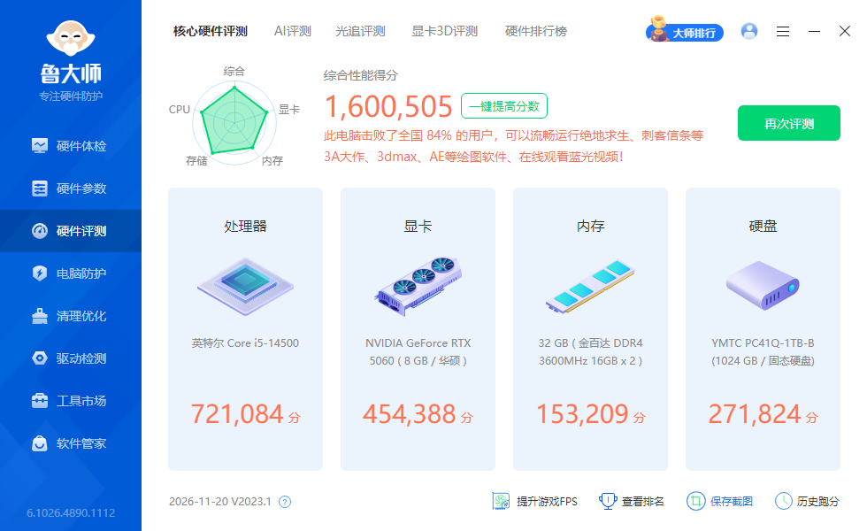

# 主力机配置（2026.11）

<NolebasePageProperties />

2026-11 新装的主力机，日常写代码、开 Docker 容器、跑前端项目，偶尔打打《绝地求生》《刺客信条》。跑了一遍鲁大师，综合 **1,600,505** 分，超过了全国 **84%** 的用户。

## 整体配置速览

| 部件 | 型号 | 备注 |
|---|---|---|
| 处理器 | 英特尔 Core i5-14500 | 14 核 20 线程，2.61 GHz |
| 主板 | 微星 B760M GAMING PLUS WIFI DDR4 | B760 芯片组，带 Wi-Fi 6E |
| 显卡 | 华硕 NVIDIA GeForce RTX 5060 | 8 GB 显存 |
| 内存 | 金百达 DDR4 3600MHz 16GB × 2 | 双通道 32 GB |
| 主硬盘 | YMTC PC41Q-1TB-B | PCIe 4.0 ×4，8000 MB/s |
| 副硬盘 | 希捷 ST8000VX009 | 8 TB 仓库盘，5400 转 |
| 显示器 | 惠科 HKC G27H2Max | 27 英寸 2560×1440 |
| 系统 | Windows 11 专业版 64 位（25H2） | DirectX 12 |

## 鲁大师硬件评测

| 分项 | 分数 |
|---|---|
| 综合性能 | **1,600,505** 分 |
| 处理器 | 721,084 分 |
| 显卡 | 454,388 分 |
| 内存 | 153,209 分 |
| 硬盘 | 271,824 分 |

:::tip 原始检测报告
完整硬件清单见桌面上的 `鲁大师硬件检测报告.html`，检测时间 2026-11-20 18:34。
:::

## 详细硬件参数

### CPU —— 英特尔 Core i5-14500

| 项目 | 值 |
|---|---|
| 核心 / 线程 | 14 / 20 |
| 基础频率 | 2.61 GHz |
| 插槽 | U3E1（LGA1700） |
| 一级数据缓存 | 6 × 32 KB + 8 × 64 KB |
| 一级代码缓存 | 6 × 48 KB + 8 × 32 KB |
| 二级缓存 | 6 × 1.25 MB + 2 × 2 MB |
| 三级缓存 | 24 MB |
| 指令集 | MMX / SSE / SSE2 / SSE3 / SSSE3 / SSE4.1 / SSE4.2 / HTT / EM64T / EIST / Turbo Boost |

### 显卡 —— 华硕 RTX 5060

| 项目 | 值 |
|---|---|
| 主显卡 | NVIDIA GeForce RTX 5060 |
| 显存 | 8 GB |
| 核心 / 显存频率 | 2280 MHz / 14001 MHz |
| 制造商 | 华硕 |
| BIOS 版本 | 98.06.39.80.2e |
| 驱动 | 32.0.16.1692（2026-09-04） |
| 核显 | 英特尔 UHD Graphics 770（128 MB） |

### 主板 —— 微星 B760M GAMING PLUS WIFI DDR4

| 项目 | 值 |
|---|---|
| 主板型号 | MS-7D99 |
| 芯片组 | B760（LPC Controller / eSPI Controller） |
| 主板版本 | 4.0 |
| BIOS | American Megatrends M.70，发布日期 2026-03-11 |
| BIOS 大小 | 16 MB |
| 序列号 | 07D9940805977Q31B000099 |

### 内存 —— 金百达 DDR4 3600

| 项目 | 值 |
|---|---|
| 插槽 1 | Controller0-DIMMA2 |
| 插槽 2 | Controller1-DIMMB2 |
| 单条容量 / 频率 | 16 GB / 3600 MHz |
| 厂商 | KINGBANK（金百达） |
| 制造日期 | 2025 年第 38 周 |
| 模块电压 | SSTL 1.2V |

### 硬盘

**主硬盘 —— YMTC PC41Q-1TB-B（固态硬盘）**

| 项目 | 值 |
|---|---|
| 容量 | 1024 GB |
| 接口 | PCIe 4.0 ×4 |
| 数据传输率 | 8000 MB/s |
| 固件 | YM11D343 |
| 特性 | S.M.A.R.T / VolatileWriteCache |
| 使用次数 / 小时 | 281 次 / 488 小时 |

**副硬盘 —— 希捷 ST8000VX009（机械硬盘）**

| 项目 | 值 |
|---|---|
| 容量 | 8002 GB |
| 接口 | SATA III |
| 数据传输率 | 600 MB/s |
| 转速 | 5400 转 / 分 |
| 固件 | CV10 |
| 特性 | S.M.A.R.T / 48-bit LBA / NCQ |
| 使用次数 / 小时 | 434 次 / 924 小时 |

### 显示器 —— 惠科 HKC G27H2Max

| 项目 | 值 |
|---|---|
| 屏幕尺寸 | 27 英寸（597 mm × 336 mm） |
| 分辨率 | 2560 × 1440 |
| 宽高比 | 16 : 9 |
| 色彩 | 32 位真彩色 |
| Gamma | 2.20 |
| 固件日期 | 2025 年第 27 周 |
